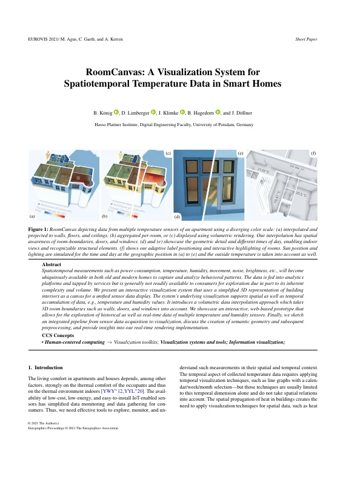
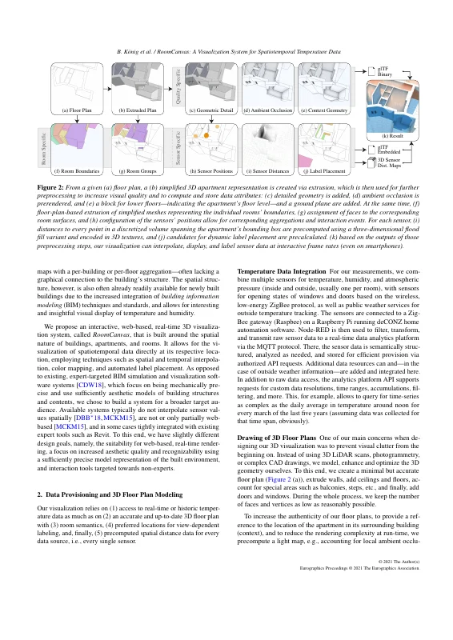
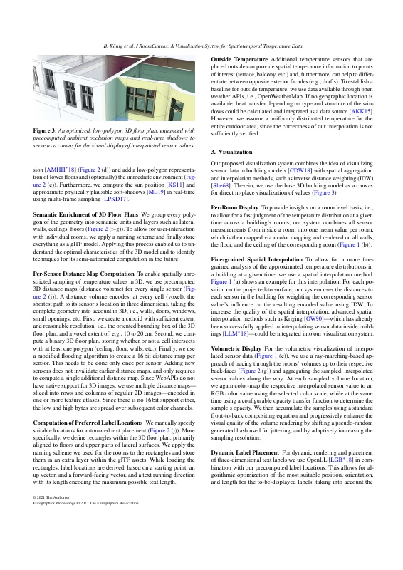
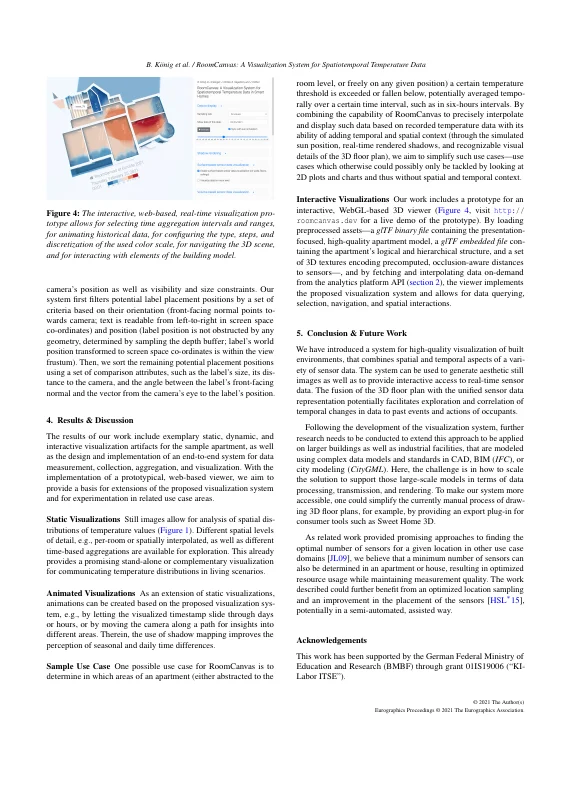
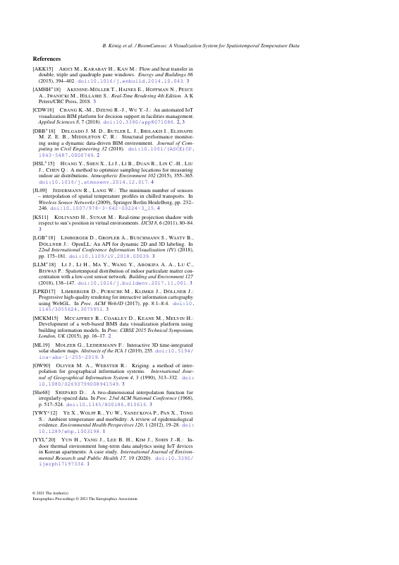

# RoomCanvas: A Visualization System for Spatiotemporal Temperature Data in Smart Homes

[Bastian König](https://orcid.org/0000-0002-8113-7863), [Daniel Limberger](https://orcid.org/0000-0002-9111-4809), [Jan Klimke](https://orcid.org/0000-0002-4650-711X), [Benjamin Hagedorn](https://orcid.org/0000-0001-9315-9333), and [Jürgen Döllner](https://orcid.org/0000-0002-8981-8583)

*EuroVis 2021 – Short Papers (EuroVis '21)*, June 14–18, 2021, virtual event. Eurographics Association, pp. 13–17.

DOI: [10.2312/evs.20211048](https://doi.org/10.2312/evs.20211048) · Author's version: Zenodo *(pending)* · [Live demo](https://roomcanvas.dev/)

> Spatiotemporal measurements such as power consumption, temperature, humidity, movement, noise, brightness, etc., will become ubiquitously available in both old and modern homes to capture and analyze behavioral patterns.
> The data is fed into analytics platforms and tapped by services but is generally not readily available to consumers for exploration due in part to its inherent complexity and volume.
> We present an interactive visualization system that uses a simplified 3D representation of building interiors as a canvas for a unified sensor data display.
> The system’s underlying visualization supports spatial as well as temporal accumulation of data, e.g., temperature and humidity values.
> It introduces a volumetric data interpolation approach which takes 3D room boundaries such as walls, doors, and windows into account.
> We showcase an interactive, web-based prototype that allows for the exploration of historical as well as real-time data of multiple temperature and humidity sensors.
> Finally, we sketch an integrated pipeline from sensor data acquisition to visualization, discuss the creation of semantic geometry and subsequent preprocessing, and provide insights into our real-time rendering implementation.

<p><a href="koenig2021-roomcanvas-as-submitted.pdf"></a> <a href="koenig2021-roomcanvas-as-submitted.pdf"></a> <a href="koenig2021-roomcanvas-as-submitted.pdf"></a> <a href="koenig2021-roomcanvas-as-submitted.pdf"></a> <a href="koenig2021-roomcanvas-as-submitted.pdf"></a></p>

## Contents

- [`src/`](src/) – LaTeX sources of the camera-ready version (Eurographics `egpubl` class, EuroVis 2021 short paper)
- [`koenig2021-roomcanvas-as-submitted.pdf`](koenig2021-roomcanvas-as-submitted.pdf) – camera-ready PDF (author build)
- [`slides/`](slides/) – LaTeX (beamer) sources of the EuroVis 2021 talk
- [`koenig2021-roomcanvas-slides.pdf`](koenig2021-roomcanvas-slides.pdf) – talk slides as presented
- [`build.sh`](build.sh) – reproducible build with TeX Live 2019 (paper) and 2020 (slides), podman or docker
- [`preview/`](preview/) – page previews for this README

## Build

```bash
./build.sh        # → build/main-cr.pdf
./build.sh slides # → build/slides/eurovis-2021-roomcanvas-presentation.pdf
```

The paper was compiled on Overleaf in 2021 (pdfTeX 1.40.21, microtype 2.7).
The TeX Live 2019 container reproduces `koenig2021-roomcanvas-as-submitted.pdf` pixel-identically; with TeX Live 2020 or later (microtype ≥ 2.8) three paragraphs break their lines differently (same text, same page count).

The slides build (TeX Live 2020) reproduces `koenig2021-roomcanvas-slides.pdf` (identical text and layout; one image on page 2 differs by a few pixels).

## Versions

- [`v1.0-camera-ready`](https://github.com/dl-archive/article.2021-eurovis-roomcanvas/tree/v1.0-camera-ready) – sources as submitted to Eurographics (2021)

## Citation

```bibtex
@InProceedings{koenig2021-roomcanvas,
  author    = {K{\"o}nig, Bastian and Limberger, Daniel and Klimke, Jan and Hagedorn, Benjamin and D{\"o}llner, J{\"u}rgen},
  title     = {RoomCanvas: A Visualization System for Spatiotemporal Temperature Data in Smart Homes},
  booktitle = {EuroVis 2021 -- Short Papers},
  year      = {2021},
  series    = {EuroVis~'21},
  publisher = {Eurographics Association},
  pages     = {13--17},
  doi       = {10.2312/evs.20211048},
  isbn      = {978-3-038681-43-4},
}
```
